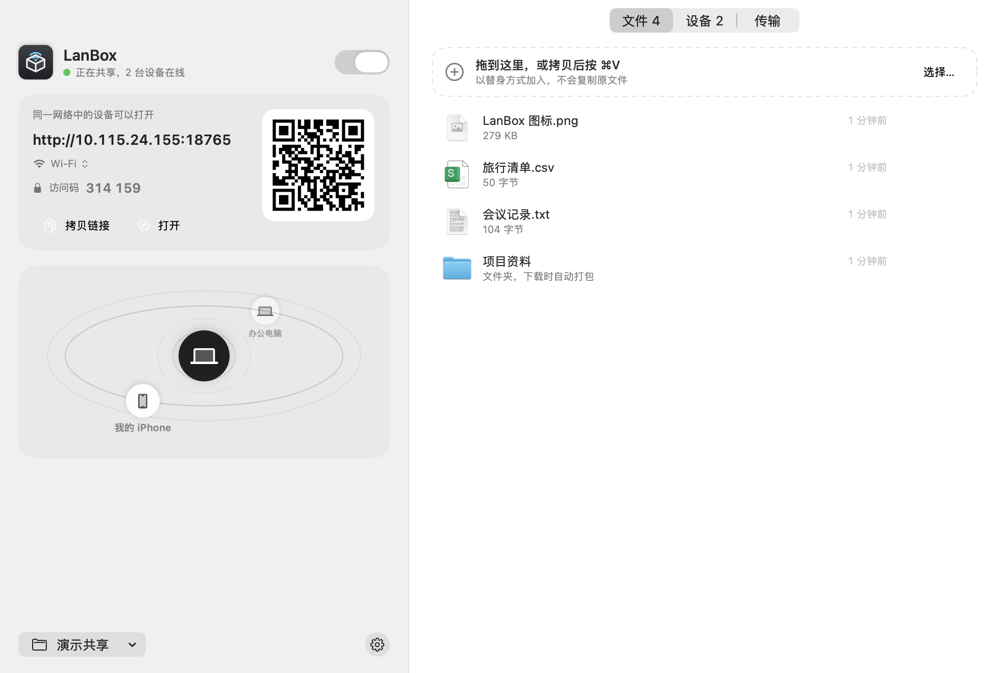
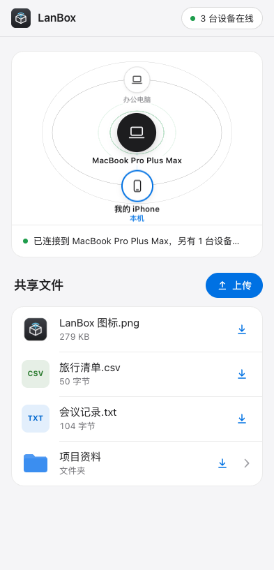
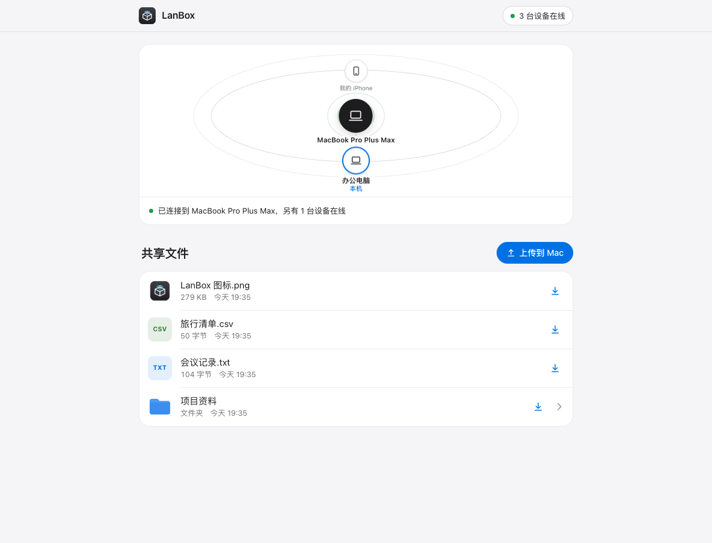

  

<h1 align="center">LanBox</h1>

<strong>把文件放进来，同一网络的设备就能拿走。</strong>

  轻巧的 macOS 局域网文件共享工具。 
  Mac 上拖入文件，手机、平板和电脑打开浏览器即可收发，无需账号或云端中转。

  
  
  

  <a href="#功能">功能</a> ·
  <a href="#界面预览">界面预览</a> ·
  <a href="#下载与使用">下载与使用</a> ·
  <a href="https://github.com/erjin-zhi/lan-box/issues">反馈问题</a>

  

## 功能

| | 能做什么 |
| --- | --- |
| **拖入即共享** | 把文件或文件夹拖到主窗口、菜单栏或 Dock 图标，也可以点击选择文件。默认以替身共享，无需先复制一份。 |
| **扫码就能连接** | 手机扫码，或在另一台电脑上打开共享链接。默认启用 6 位访问码，二维码和拷贝链接已包含访问码。 |
| **双向传文件** | 访客可以下载 Mac 上的文件，也能把文件上传回来。电脑浏览器还支持拖入整个文件夹。 |
| **粘贴也能分享** | 在 Mac 窗口或电脑网页中粘贴文件、截图或文字；文字自动保存为 TXT。 |
| **先看再下载** | 网页支持图片预览，以及浏览器可播放的音视频、PDF 和纯文本。文件夹和 App 文件包自动打包成 ZIP 下载。 |
| **传输看得见** | 查看在线设备、正在访问的内容，以及传输进度、速度和剩余时间；可停止传输、阻止设备访问或关闭上传。 |
| **随手开，随手收** | 菜单栏面板与独立主窗口都能使用，支持登录时启动、新设备和收到文件通知，也可选择固定的共享文件夹。 |

## 界面预览

  

手机扫码打开网页，即可查看共享文件、下载或上传。

  
查看电脑浏览器界面

   
  

截图来自实际运行界面，使用演示文件；手机视图由浏览器模拟移动设备尺寸。

## 下载与使用

1. 前往 **[Releases 下载最新版](https://github.com/erjin-zhi/lan-box/releases/latest)**，解压 `LanBox-1.0.0-macOS-universal.zip`，将 `LanBox.app` 拖入「应用程序」。需要 **macOS 26 或更高版本**，安装包同时支持 Apple Silicon 和 Intel。
2. 打开 LanBox，允许系统提示的局域网访问与传入连接，把需要共享的文件拖进窗口。
3. 让另一台设备连接同一网络，扫描二维码或打开拷贝的链接。点击文件可预览或下载，点击「上传到 Mac」可把文件传回来。

> [!NOTE]
> 当前版本尚未经过 Apple 公证。如果 macOS 拦截首次打开，请确认下载来源后，前往「系统设置 → 隐私与安全性」选择「仍要打开」。

### 文件放在哪里？

- **从 Mac 拖入的文件**：默认只创建替身，不复制原文件；移除替身不会删除原文件。也可在设置中切换为「拷贝一份」。原文件移动或删除后，需要重新加入共享。
- **其他设备上传的文件**：保存在当前共享文件夹。上传不会通过替身写入原始文件夹。
- **临时收到的文件**：默认使用临时共享文件夹，退出时会提醒移到「下载」。重要文件请及时保存，也可在面板底部选择一个固定文件夹。

### 连接与访问

LanBox 面向同一局域网使用，文件直接在设备间传输。当前连接使用 HTTP，适合可信的家庭或办公网络。共享链接和二维码包含访问码，请只发给需要访问的人；更换访问码后，已连接设备需要重新验证。

如果另一台设备打不开网页，请检查双方是否在同一网络、Mac 是否仍在共享，以及防火墙是否允许 LanBox 接收连接。访客 Wi-Fi 或开启设备隔离的网络可能无法互相访问。
